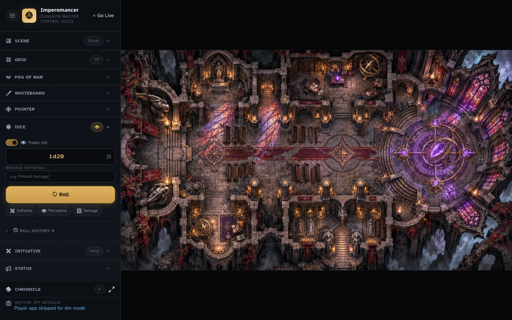
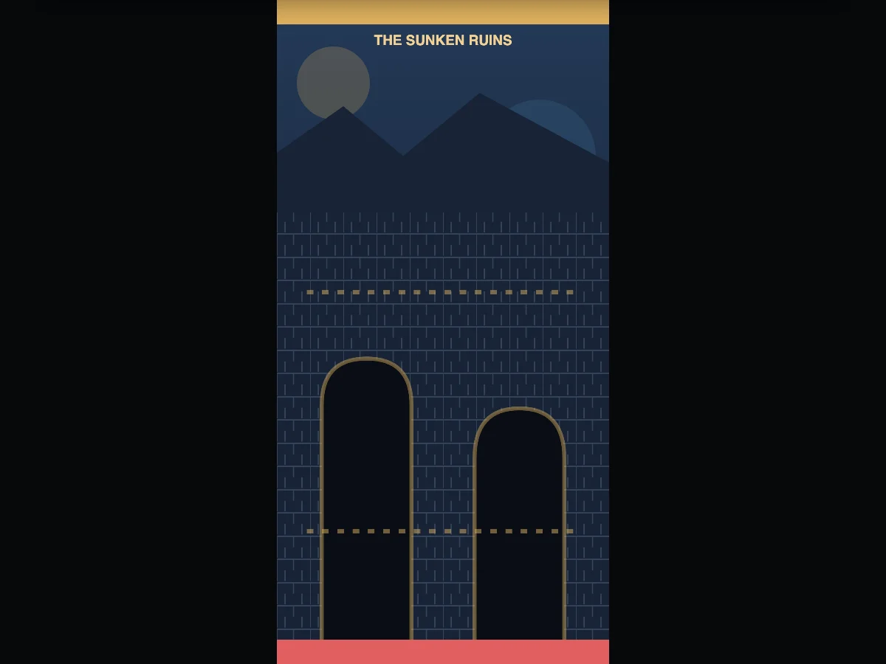

# Imperomancer media gallery

This page demonstrates the stable documentation-media paths generated by `npm run docs:media`. It can become the basis for a future public documentation or marketing page. For new captures, follow the [media extension guide](media/extending.md).

## DM scene control

## Player table display

## Fog reveal

<video controls loop muted playsinline width="900">
  <source src="assets/media/fog-reveal.webm" type="video/webm">
  Your browser does not support embedded video.
</video>

## Refreshing this page

Run [`npm run docs:media`](media/README.md#generate-or-refresh-media) after an intentional visual UI change, review the resulting WebP/WebM files, and commit the updated media with the corresponding documentation change.
