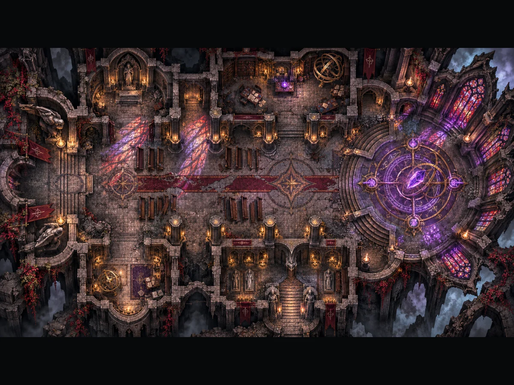

# Documentation media pipeline

This directory defines reproducible inputs for documentation imagery and video. It keeps screenshots and clips consistent with the current application rather than relying on manually captured browser windows.

## Source resources

[`resources/`](resources/) contains named, deterministic fixtures used by the capture suite. Do not replace a resource silently: a renamed or materially changed fixture changes the visual contract of every image that uses it.

`Arcane_Cathedral.png` is the base scene for DM and Player scene-publishing media. `Dwarven_Forge.png` is the base scene for the fog-reveal video. You may use one fixture for multiple captures when the same scene explains both workflows. After adding or renaming a file, update the recipe’s `imageFixtureDataUrl('filename.ext')` call to match it.

| File | Purpose |
| --- | --- |
| [`Arcane_Cathedral.png`](resources/Arcane_Cathedral.png) | Base scene for DM and Player scene-publishing media. |
| [`Dwarven_Forge.png`](resources/Dwarven_Forge.png) | Base scene for the fog-reveal video. |

SVG is useful because it is versionable and quick to load, but it is not required. Source fixtures may be PNG, JPEG, WebP, AVIF, GIF, or SVG. Choose the original, publishable image format rather than converting artwork purely for the pipeline.

## Generated assets

The capture command writes these named assets to [`../assets/media/`](../assets/media/):

| File | Format | Use |
| --- | --- | --- |
| `dm-scene-control.webp` | WebP | DM scene-management overview. |
| `player-scene-table.webp` | WebP | Player/table view with a prepared scene. |
| `player-fog-reveal.webm` | WebM | Player/table before/after fog-reveal demonstration. |

The [media gallery](../media-gallery.md) catalogues the broader feature library. It includes static WebP reference states for configuration and comparison, and WebM clips for actions where motion is the lesson: transitions, fog reapplication, whiteboard drawing, focus pings, turn changes, public results, and announcements.

These filenames are stable so Markdown pages, website content, and future publishing tooling can link to them without finding an opaque timestamped artifact.

## Generate or refresh media

Install dependencies and Playwright Chromium once:

```sh
npm install
npx playwright install chromium
```

Then run:

```sh
npm run docs:media
```

The command starts a local Vite server, runs only the tagged documentation-media tests, and overwrites the named files above. Review each updated asset before committing it: generated media is product documentation, not a disposable test artifact.

Regenerate only the motion demonstrations while refining timing or pacing:

```sh
npm run docs:media:motion
```

## Use assets in Markdown

Reference a screenshot with normal Markdown:

```md

```

Use HTML video for WebM because standard Markdown has no portable video syntax:

```html
<video controls loop muted playsinline>
  <source src="../assets/media/player-fog-reveal.webm" type="video/webm">
  Your browser does not support embedded video.
</video>
```

The companion [media gallery](../media-gallery.md) is a working reference for these paths.

## Architecture and file locations

The pipeline deliberately separates inputs, output, reusable code, and feature-specific code:

```text
docs/media/resources/             deterministic, publishable source fixtures
docs/assets/media/                committed WebP and WebM output files
e2e/docs-media.spec.js            generic tagged Playwright harness
e2e/docs-media/helpers.js         shared fixture, mounting, path, and video helpers
e2e/docs-media/capture-utils.js   shared DM/Player setup and stable screenshot helpers
e2e/docs-media/index.js           explicit capture registry and validation
e2e/docs-media/captures/          one focused recipe module per feature/story
docs/media/extending.md           detailed recipe authoring guide
```

[`e2e/docs-media.spec.js`](../../e2e/docs-media.spec.js) never contains feature-specific behavior. It validates the registry, creates a serial Playwright test for each registered recipe, and stays disabled unless `CAPTURE_DOCS_MEDIA=true`. The `docs:media` npm script supplies that variable; ordinary `npm run test:e2e` runs safely without overwriting committed documentation assets.

Each recipe owns its complete list of output filenames. The registry rejects duplicate IDs, duplicate filenames, malformed IDs, and any output name that is not lowercase kebab-case and prefixed `dm-` or `player-` before Playwright opens a browser. Stable output names are part of the documentation API: Markdown, a future website, and publishing tooling can safely link to them.

## Adding a feature capture

The extension workflow is intentionally small:

1. Put a fixed, safe-to-publish fixture directly in [`resources/`](resources/) when the capture needs one. PNG, JPEG, WebP, AVIF, GIF, and SVG are supported; use the clearest original image available rather than converting artwork solely for the pipeline.
2. Create one recipe in [`e2e/docs-media/captures/`](../../e2e/docs-media/captures/). It declares an ID, title, output names, and an async `run` method.
3. Import and register the recipe in [`e2e/docs-media/index.js`](../../e2e/docs-media/index.js).
4. Reference the named output from an appropriate knowledge-base page and/or [media gallery](../media-gallery.md).
5. Run `npm run docs:media`, visually inspect every changed asset, then run the normal regression checks.

Use a fresh browser context with an explicit viewport and `deviceScaleFactor: 1` in every recipe. Assert that the intended state is visible before capturing. Keep each recipe to one feature and one teaching objective; use separate DM and Player assets when that explains the workflow more clearly.

For the exact recipe contract, WebP and WebM templates, shared-helper reference, output naming rules, review checklist, and troubleshooting, read [Extending the documentation media pipeline](extending.md).

## Current capture inventory

The capture recipes create both reference states and motion demonstrations. WebP explains a stable configuration or final result; WebM is reserved for a workflow where timing, movement, or an evolving shared display is important.

| Feature | WebP references | WebM demonstrations |
| --- | --- | --- |
| Scenes | preparation, publication, transition choice | fade transition |
| Grid | calibration, applied grid, physical lock | — |
| Fog | application, repaint/reapplication controls | reveal and reapply workflows |
| Whiteboard | full shared board | marks appearing on the board |
| Focus pointer | placed coloured pings | animated focus ping |
| Dice | public/private settings, notation, history | public result display |
| Initiative | population, entry, tracker, editing, defeated state | advancing the active turn |
| Shape tools | DM palette/layer controls, Player tactical geometry | — |
| Status | announcement state | table announcement appearance |
| Chronicle | expanded view, level filter, feature search | — |

The exact, committed filenames and embeddable examples are in the [media gallery](../media-gallery.md). Each row is backed by a focused recipe in [`e2e/docs-media/captures/`](../../e2e/docs-media/captures/), with common setup isolated in [`capture-utils.js`](../../e2e/docs-media/capture-utils.js).

## Contributor safeguards

- Never create output files by hand; a registered recipe must own them.
- Never capture private campaign data, account information, local paths, unlicensed art, remote-site content, or random/time-dependent state.
- Keep videos brief, deliberate, and focused on one visible action. Use WebP for a stable state and WebM only when motion explains the feature.
- Do not add one-off logic to `docs-media.spec.js`; use a focused capture module, and promote logic to `helpers.js` only when it is genuinely reusable.
- Review composition, legibility, current UI labels, Player/DM visibility boundaries, and documentation links before committing.
